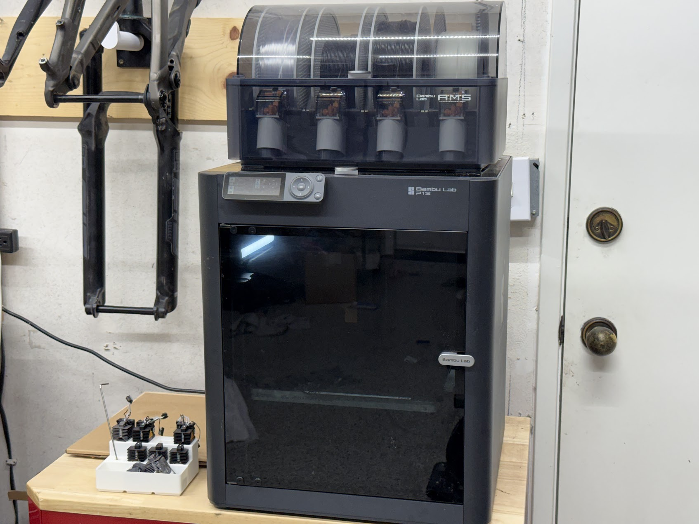
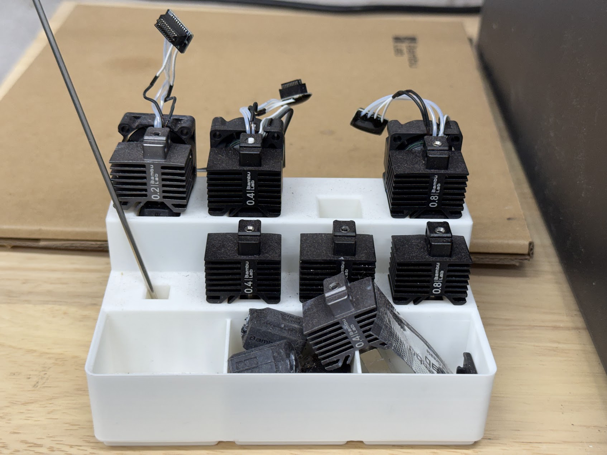

---
title: "My 3D Printing Setup: Printers, Nozzles, and Filament"
date: 2026-01-15
draft: false
description: "The 3D printers, nozzle sizes, and filament I use for functional parts: a Bambu Lab P1S with AMS, a Flashforge Creator 5 Pro, and why I run a 0.6 mm nozzle."
categories: ["Gear"]
tags: ["setup", "Bambu Lab", "Flashforge"]
cover:
  image: /posts/my-3d-printing-setup/printer.jpg
  alt: "Bambu Lab P1S with AMS 3D printer setup"
  relative: false
---

I'm Jared — an engineer who likes to tinker. I mostly print practical stuff: bike parts, things for my kids, fixes around the house, desk organization, and the occasional electromechanical project. Here's what I'm running.

## Printer

**Bambu Lab P1S with AMS**

I've had it for over a year and it's been solid. Coming from the tinkering side of the hobby, the P1S felt almost too easy at first — but I've learned to appreciate just hitting print and having it work.

The AMS makes multi-color prints easy, but honestly I use it more for convenience. I can load up a few rolls and not worry about swapping filament mid-print.

## Nozzles

I have the full set: 0.2mm, 0.4mm, 0.6mm, and 0.8mm.

The **0.6mm** is my go-to. It speeds up prints significantly — 30-40% faster on a lot of models — and unless I really need fine detail, most stuff still looks good. Layer lines are slightly more visible but for functional prints, who cares.

The **0.2mm** comes out for small detailed parts where I need crisp edges. The **0.8mm** is great for big functional prints where strength matters more than looks.

## Filament

I mostly print in PLA, PETG, ASA, and TPU. PLA for quick stuff, PETG for anything that needs to handle heat or stress, ASA for outdoor parts where UV exposure is a factor, and TPU when I need flexibility. My go-to brands are Polymaker, HATCHBOX, and ELEGOO.

If you're choosing between materials, start with [PLA vs PETG](/posts/pla-vs-petg/), then [PLA vs PETG vs ASA for outdoor prints](/posts/pla-vs-petg-vs-asa-outdoor-prints/). For brands, see the [PETG brands comparison](/posts/best-petg-filament-brands-functional-parts/), and check the [filament prices page](/filament-prices/) for what each spool costs per kg today.

## Second Printer: Flashforge Creator 5 Pro

In November 2026 I added a Flashforge Creator 5 Pro next to the P1S. It has four independent toolheads, a heated chamber, and a dedicated nozzle for each material, which suits the ASA and carbon-fiber nylon parts I've been printing more of. The P1S stays as the fast PLA and PETG machine. I wrote up the reasoning in [why I chose the Creator 5 Pro over the Bambu H2D](/posts/why-i-chose-flashforge-creator-5-pro/), and you can read [my P1S review after 1,000+ hours](/posts/bambu-p1s-review-1000-hours/) for how the first printer has held up.

## What's Next

I'm documenting projects here and on YouTube at [@MizuMakes3D](https://youtube.com/@MizuMakes3D). More soon.
